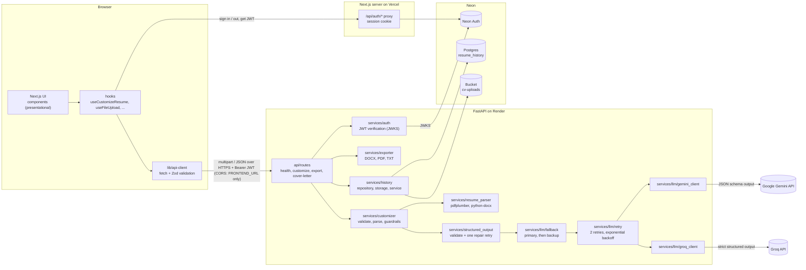

# Quillvita

Quillvita tailors a resume to a specific job posting. Paste a job description, upload a PDF or DOCX
resume, and an LLM rewrites the summary, skills, experience and projects to mirror the role's
language without inventing anything. You get a resume-style preview, a match score and ATS score
with tips, the skills you already match, keywords you are missing (with reasons), every change
explained, a side-by-side diff, an optional cover letter, and downloads as DOCX, PDF or TXT.

Signing in is optional. Signed-in users get a history: every resume they tailor is saved with its
results, so they can reopen a past run, download the original file again, or delete it. Accounts
use Neon Auth, results are stored in Neon Postgres, and the uploaded files go to a Neon storage
bucket.

## Pages

| Route                            | What it is                                                                                              |
| -------------------------------- | ------------------------------------------------------------------------------------------------------- |
| `/`                              | Landing page: hero with a product preview, how it works, features, the truthfulness rules, privacy, FAQ |
| `/tailor`                        | The tool: job description and upload form, then the results                                             |
| `/history`, `/history/<id>`      | Saved runs for signed-in users                                                                          |
| `/auth/sign-in`, `/auth/sign-up` | Neon Auth forms; afterwards users go to `?next=` or `/tailor`                                           |

Every page is responsive from 320 px phones to wide desktops. Below `lg` (1024 px) the header
collapses into a menu button with a full-width panel; the results tabs switch to short labels on
phones, the insights sidebar stacks under the results below `lg`, and all touch targets are at
least 44 px.

## Tech stack

| Layer    | Choice                                                                         |
| -------- | ------------------------------------------------------------------------------ |
| Frontend | Next.js 16 (App Router), React 19, TypeScript (strict), Tailwind CSS v4, Zod 4 |
| Backend  | Python 3.11+, FastAPI, Pydantic v2, pydantic-settings, pdfplumber, python-docx |
| Export   | python-docx (DOCX), fpdf2 with bundled Noto Sans (PDF), plain text             |
| LLM      | Google Gemini (`google-genai`), with Groq (`groq`) as automatic backup         |
| Accounts | Neon Auth (`@neondatabase/auth`), JWTs verified by the backend with PyJWT      |
| Storage  | Neon Postgres (`psycopg` 3 + `psycopg-pool`), Neon object storage via `boto3`  |
| Tooling  | ESLint, Prettier, Vitest, Ruff, mypy `--strict`, pytest                        |
| Hosting  | Vercel (frontend), Render (backend, Docker), Neon (auth, database, files)      |

## LLM providers and models

Two free-tier providers sit behind one interface. The rest of the app only sees `LLMClient`:

```python
class LLMClient(Protocol):
    async def generate_json(self, system: str, user: str, *, schema: JsonSchema) -> str: ...
```

| Role    | Provider                            | SDK            | Model env var | Configured model      |
| ------- | ----------------------------------- | -------------- | ------------- | --------------------- |
| Primary | Google Gemini (AI Studio free tier) | `google-genai` | `LLM_MODEL`   | `gemini-3.8-flash`    |
| Backup  | Groq (free tier)                    | `groq`         | `GROQ_MODEL`  | `openai/gpt-oss-120b` |

`LLM_PROVIDER` (`gemini` or `groq`, default `gemini`) picks the primary; the other one is the
backup. Model names are never hardcoded.

- **Gemini.** `gemini-3.8-flash` is the current stable Gemini 3 Flash model and is free on AI
  Studio. Gemini 1.x, 2.0 and 2.5 model ids are rejected at startup because those families are
  being shut down. Gemini 3 ignores `temperature` (future models reject it), so the client sends a
  `low` thinking level instead, with a 45 s timeout. JSON mode uses `response_json_schema`.
- **Groq.** `openai/gpt-oss-120b` is a production model on the Groq free tier (30 requests/min,
  1,000 requests/day, 8,000 tokens/min). The client uses strict structured outputs
  (`response_format` with `strict: true`; the schema is converted to Groq's strict subset), a
  temperature of 0.3, `low` reasoning effort, and a 30 s timeout.
- Provider-specific settings (timeouts, temperature, thinking or reasoning level) are constants in
  `gemini_client.py` and `groq_client.py`. Both providers get the same system prompt, the same JSON
  schema, the same Pydantic validation and the same single repair retry.

**Retries and fallback** (`services/llm/retry.py`, `services/llm/fallback.py`):

1. On a 429 rate limit, a timeout or a 5xx error, the primary is retried up to 2 times with
   exponential backoff (1 s, then 2 s, plus jitter). A short server-suggested wait (up to 10 s) is
   honored; an exhausted daily quota or a long suggested wait skips straight to the fallback. Each
   provider gets at most twice its per-call timeout, retries included.
2. If the primary still fails, the request goes to the backup provider (with the same retries),
   but only if its API key and model are configured.
3. If both fail, the API returns `503 llm_busy` with `Retry-After: 60` and the message "The AI
   service is busy right now. Please try again in a minute."

Configuration errors (bad key, unknown model) and invalid output are not retried on the other
provider, since they point to a setup or prompt problem rather than a busy service.

The logs record which provider and model handled each request, how long it took, and the error
codes behind retries and fallbacks. They never contain resume text, job descriptions, model output
or API keys.

## Accounts and history (Neon)

The Neon project (`Quillvita`, branch `production`) is linked to this repository and described in
`neon.ts`:

```ts
export default defineConfig({
  auth: true,
  preview: { buckets: { "cv-uploads": { access: "public_read" } } },
});
```

`neon deploy` applies it (Neon Auth enabled, bucket `cv-uploads` created). `neon env pull` writes
the connection details to the root `.env.local`; copy them into `backend/.env` and
`frontend/.env.local` as listed under [Environment variables](#environment-variables).

How it fits together:

1. **Sign up, sign in, sign out.** `/auth/sign-up` and `/auth/sign-in` call Neon Auth through the
   Next.js proxy at `/api/auth/*`, which keeps the session in an HTTP-only cookie. The header (or
   the mobile menu) shows the signed-in email, a History link and Sign out. `src/proxy.ts` sends
   signed-out visitors from `/history` to sign-in and back again afterwards; other sign-ins land
   on `/tailor`.
2. **Calling the backend.** Before an API call, the browser gets a short-lived (15 minute) JWT
   from `/api/auth/token` and sends it as `Authorization: Bearer <jwt>`. FastAPI verifies the
   EdDSA signature against Neon Auth's JWKS, plus the issuer, audience and expiry.
3. **Saving a run.** When a signed-in user tailors a resume, the backend uploads the original file
   to the bucket at `users/<user id>/<entry id>/<file name>` and inserts a `resume_history` row in
   Postgres with the job title, job description, scores and the full result as JSONB. Anonymous
   users get exactly the old behavior: nothing is stored.
4. **History.** `/history` lists past runs, `/history/<id>` reopens the full result, "Original"
   downloads the uploaded file through a presigned URL that expires after 5 minutes, and Delete
   removes both the row and the file.

The backend creates its table on startup if it does not exist:

```sql
create table resume_history (
  id uuid primary key,
  user_id uuid not null references neon_auth."user"(id) on delete cascade,
  created_at timestamptz not null default now(),
  job_title text not null, job_description text not null,
  file_name text not null, file_key text not null, file_content_type text not null,
  file_size_bytes integer not null,
  match_score smallint not null, ats_score smallint not null,
  result jsonb not null
);
```

Every query filters by the user id from the verified token, so one user can never read, download
or delete another user's entries (a foreign id returns 404).

History is optional. If the Neon variables are missing, the backend logs that history is off,
anonymous tailoring keeps working, and the history endpoints return `503 history_unavailable`
(or `401` when Neon Auth itself is not configured, since no token can be verified).

## Local setup

Prerequisites: Node.js 20.9+, Python 3.11+, a Gemini API key from
[Google AI Studio](https://aistudio.google.com/apikey) and, optionally, a Groq API key from the
[Groq console](https://console.groq.com/keys) for the backup provider. One key is enough to run
the app. For accounts and history you also need the Neon CLI (`npm i -g neon`) and access to the
Neon project.

### Neon

```bash
neon login
neon link --project-id misty-violet-78378510 --branch production -y
neon env pull                 # writes .env.local in the repo root (git-ignored)
```

### Backend

```bash
cd backend
python -m venv .venv
# Windows: .venv\Scripts\activate    macOS/Linux: source .venv/bin/activate
pip install -r requirements-dev.txt
cp .env.example .env          # set GEMINI_API_KEY (and GROQ_API_KEY), plus the Neon values
uvicorn app.main:app --reload --port 8000
```

Checks:

```bash
ruff check . && ruff format --check . && mypy . && pytest
```

### Frontend

```bash
cd frontend
npm install
cp .env.example .env.local    # NEXT_PUBLIC_API_URL, NEON_AUTH_BASE_URL, NEON_AUTH_COOKIE_SECRET
npm run dev                   # http://localhost:3000
```

Checks:

```bash
npm run lint && npm run typecheck && npm run test && npm run build
```

## Environment variables

| Variable                                     | Where    | Required                            | Default                 | Description                                                                                               |
| -------------------------------------------- | -------- | ----------------------------------- | ----------------------- | --------------------------------------------------------------------------------------------------------- |
| `LLM_PROVIDER`                               | backend  | no                                  | `gemini`                | Primary provider: `gemini` or `groq`. The other is the backup.                                            |
| `GEMINI_API_KEY`                             | backend  | one of the two keys                 | none                    | Gemini API key. Never commit it.                                                                          |
| `LLM_MODEL`                                  | backend  | with Gemini key                     | none                    | Gemini 3 Flash-class model id, e.g. `gemini-3.8-flash`.                                                   |
| `GROQ_API_KEY`                               | backend  | one of the two keys                 | none                    | Groq API key. Never commit it.                                                                            |
| `GROQ_MODEL`                                 | backend  | with Groq key                       | none                    | Groq model id, e.g. `openai/gpt-oss-120b`.                                                                |
| `FRONTEND_URL`                               | backend  | yes                                 | `http://localhost:3000` | The only origin allowed by CORS (no trailing slash).                                                      |
| `MAX_FILE_SIZE_MB`                           | backend  | no                                  | `5`                     | Upload limit (1–20).                                                                                      |
| `DATABASE_URL`                               | backend  | for history                         | none                    | Neon Postgres connection string (pooled). Secret.                                                         |
| `NEON_AUTH_BASE_URL`                         | both     | backend: for history; frontend: yes | none                    | Neon Auth URL, e.g. `https://ep-xxx.neonauth.<region>.aws.neon.tech/neondb/auth`.                         |
| `NEON_AUTH_JWKS_URL`                         | backend  | for history                         | none                    | Neon Auth JWKS URL, used to verify JWTs.                                                                  |
| `STORAGE_BUCKET`                             | backend  | no                                  | `cv-uploads`            | Neon storage bucket for uploaded resumes.                                                                 |
| `AWS_ACCESS_KEY_ID`, `AWS_SECRET_ACCESS_KEY` | backend  | for history                         | none                    | Neon storage credentials (S3-compatible). Secret.                                                         |
| `AWS_ENDPOINT_URL_S3`, `AWS_REGION`          | backend  | for history                         | none                    | Neon storage endpoint and region.                                                                         |
| `NEXT_PUBLIC_API_URL`                        | frontend | yes                                 | none                    | Public URL of the backend, e.g. `https://quillvita-api.onrender.com`.                                      |
| `NEON_AUTH_COOKIE_SECRET`                    | frontend | yes                                 | none                    | At least 32 random characters (`openssl rand -base64 32`). Signs the session cookie. Secret, server-only. |
| `NEXT_PUBLIC_SITE_URL`                       | frontend | with a custom domain                | Vercel production URL   | Public site URL for canonical links, Open Graph images, `sitemap.xml` and `robots.txt`.                   |

A provider is used only when both its key and its model are set. If neither is configured, LLM
requests fail with `503 llm_not_configured`.

The Neon values come from `neon env pull`. History turns on only when all of the backend's Neon
variables are set. The frontend always needs `NEON_AUTH_BASE_URL` and `NEON_AUTH_COOKIE_SECRET`,
since the auth proxy and the `/history` route protection depend on them.

Templates live in `backend/.env.example`, `frontend/.env.example`, and a combined reference in
`.env.example`. None contain real keys.

## Architecture



Request flow for `POST /api/customize`:

1. The browser validates the job description length and the file's extension, MIME type, size and
   magic bytes before uploading.
2. The backend repeats every check (extension, MIME, `%PDF-` / ZIP + `word/document.xml`
   signature, size) and extracts text, including DOCX table cells and headers.
3. Text under 50 characters is rejected as a scanned or empty document.
4. The prompt wraps resume and job description in delimiter tags and treats both as untrusted data.
5. The model output is validated against `LLMCustomization`; on failure, one repair prompt is sent
   with the validation errors, then a clear error is returned.
6. Guardrails run on the result (see below) and the response is validated again on the client with
   Zod.

## API

All errors use one shape: `{ "error": { "code": string, "message": string } }`.

| Method | Path                     | Body                                                                                                                                     | Response                                                                                                                                                                                                                                         |
| ------ | ------------------------ | ---------------------------------------------------------------------------------------------------------------------------------------- | ------------------------------------------------------------------------------------------------------------------------------------------------------------------------------------------------------------------------------------------------ |
| GET    | `/api/health`            | none                                                                                                                                     | `{ "status": "ok" }`                                                                                                                                                                                                                             |
| POST   | `/api/customize`         | multipart: `resume` (file), `job_description` (string), `sections` (repeatable, optional: `summary`, `skills`, `experience`, `projects`) | `CustomizeResponse`: `original`, `tailored` (ResumeContent), `matched_skills`, `suggested_keywords[{keyword, reason}]`, `scores{match_score, match_justification, ats_score, ats_tips}`, `changes[{section, before, after, reason}]`, `sections` |
| POST   | `/api/export`            | JSON `{ "resume": ResumeContent, "format": "docx" \| "pdf" \| "txt" }`                                                                   | File download, `Content-Disposition: attachment; filename="Name_Resume_Tailored.docx"`                                                                                                                                                           |
| POST   | `/api/cover-letter`      | JSON `{ "resume": ResumeContent, "job_description": string, "tone": "professional" \| "enthusiastic" \| "concise" }`                     | `{ greeting, paragraphs[], closing, signature }`                                                                                                                                                                                                 |
| GET    | `/api/history`           | none (auth required)                                                                                                                     | `{ items: [{ id, created_at, job_title, file_name, match_score, ats_score }] }`, newest first                                                                                                                                                    |
| GET    | `/api/history/{id}`      | none (auth required)                                                                                                                     | Summary fields plus `job_description` and `result` (`CustomizeResponse`)                                                                                                                                                                         |
| GET    | `/api/history/{id}/file` | none (auth required)                                                                                                                     | `{ url, file_name }`: presigned download URL, valid for 5 minutes                                                                                                                                                                                |
| DELETE | `/api/history/{id}`      | none (auth required)                                                                                                                     | `204`, deletes the row and the stored file                                                                                                                                                                                                       |

`POST /api/customize` accepts an optional `Authorization: Bearer <jwt>`. With a valid token the run
is saved and the response includes `history_id`; without one it behaves as before. An invalid or
expired token returns 401 instead of silently not saving.

Error codes: `invalid_file_type` (415), `file_too_large` (413), `unreadable_file`,
`no_extractable_text`, `invalid_input`, `invalid_request` (422), `llm_invalid_output` (502),
`llm_busy` (503, with `Retry-After: 60`, when every provider is rate limited, timing out or
failing), `llm_not_configured` (503), `unauthorized` (401), `not_found` (404),
`history_unavailable` (503), `internal_error` (500).

Interactive docs are served by FastAPI at `/docs`.

## Deployment

### Backend on Render

1. Push the repository to GitHub.
2. In Render, choose **New > Blueprint**, select the repo. Render reads `render.yaml` and creates
   the `quillvita-api` Docker web service (`backend/Dockerfile`, health check `/api/health`) in
   the Singapore region, next to the Neon database (`aws-ap-southeast-1`).
3. When prompted, set `GEMINI_API_KEY`, `GROQ_API_KEY` and `FRONTEND_URL` (your Vercel URL, e.g.
   `https://quillvita.vercel.app`, no trailing slash). `LLM_PROVIDER` (`gemini`), `LLM_MODEL`
   (`gemini-3.8-flash`) and `GROQ_MODEL` (`openai/gpt-oss-120b`) are preset. For history, also set
   `DATABASE_URL`, `NEON_AUTH_BASE_URL`, `NEON_AUTH_JWKS_URL`, `AWS_ACCESS_KEY_ID`,
   `AWS_SECRET_ACCESS_KEY`, `AWS_ENDPOINT_URL_S3` and `AWS_REGION` from `neon env pull`
   (`STORAGE_BUCKET` is preset to `cv-uploads`).
4. Deploy and confirm `https://<service>.onrender.com/api/health` returns `{"status":"ok"}`.

Without Blueprints: **New > Web Service**, runtime Docker, Dockerfile path `backend/Dockerfile`,
build context `backend`, health check path `/api/health`, then add the same env vars. The container
listens on `0.0.0.0:$PORT`.

### Frontend on Vercel

1. In Vercel, **Add New > Project**, import the repo.
2. Set **Root Directory** to `frontend`. The framework (Next.js) is detected automatically.
3. Add `NEXT_PUBLIC_API_URL` = your Render URL (e.g. `https://quillvita-api.onrender.com`),
   `NEON_AUTH_BASE_URL` (from `neon env pull`) and `NEON_AUTH_COOKIE_SECRET` (a new random value,
   not the local one) for Production and Preview.
4. Deploy. If the Vercel URL differs from what you set as `FRONTEND_URL` on Render, update it there
   and redeploy the backend, since CORS only allows that exact origin.
5. Add the Vercel domain to Neon Auth's trusted domains so sign-in is accepted from it:
   `neon neon-auth domain add https://quillvita.vercel.app`.
6. If you use a custom domain, set `NEXT_PUBLIC_SITE_URL` to it (e.g. `https://quillvita.app`) and
   redeploy, so canonical links and the sitemap point there. Without it, Vercel's production URL is
   used. Then submit `https://<your domain>/sitemap.xml` in Google Search Console.

## SEO and performance

- **Metadata.** Every page has its own title and description. The landing page and `/tailor` have
  canonical URLs, Open Graph and Twitter cards, and a generated 1200×630 share image
  (`app/opengraph-image.tsx`). Sign-in, sign-up and history pages are `noindex`.
- **Crawling.** `robots.txt` allows everything except `/history` and `/api/`, and points to
  `sitemap.xml`, which lists `/` and `/tailor`.
- **Structured data.** The landing page publishes JSON-LD for `WebSite`, `WebApplication` (free,
  with its feature list) and `FAQPage`, generated from the same list the FAQ section renders.
- **Icons.** A vector `icon.svg`, a generated Apple touch icon and a web app manifest.
- **Core Web Vitals.** Every page is prerendered. Inter is self-hosted by `next/font` with a
  size-matched fallback, so there's no layout shift (CLS 0). The browser preconnects to the API
  (sent as an HTTP `Link` header) so the warm-up and tailoring requests skip the connection setup.
- **Smaller JavaScript.** The Neon Auth SDK is the largest client dependency (about 130 KB
  compressed). It loads only where it's needed: the desktop header's account actions (lazily, after
  the page is interactive), the mobile menu's account section (when the menu opens) and the sign-in
  forms. API calls get their token from `/api/auth/token` and the tailor page checks the session
  with one request to `/api/auth/get-session`, so neither needs the SDK.

Lighthouse on a local production build (`npm run build && npm start`), mobile emulation:

| Page      | Performance (mobile / desktop) | Accessibility | Best practices | SEO |
| --------- | ------------------------------ | ------------- | -------------- | --- |
| `/`       | 85–92 / 96                     | 100           | 100            | 100 |
| `/tailor` | 73–87 / 97                     | 100           | 100            | 100 |

Before these changes the landing page scored 66 on mobile, with 1.5 s of main-thread blocking. Local
mobile scores vary between runs because Lighthouse scales its CPU throttling from the machine's
speed; PageSpeed Insights on the deployed site gives the representative numbers.

## Design system

`frontend/DESIGN.md` documents the Linear-inspired design system. Its tokens are defined once as CSS
variables in `src/app/globals.css` and mapped into Tailwind in `tailwind.config.ts` (colors,
typography scale, spacing, radii, shadows, motion). Components only use those token classes.

## Decisions and trade-offs

- **Name: Quillvita.** "Quill" for writing, "vita" as in curriculum vitae. It replaced the working
  name TailorCV, which was too generic. Before choosing it we searched the web (no product or
  company uses it) and checked that `quillvita.com`, `.app` and `.io` were unregistered. The `/tailor`
  route keeps its name because it describes the action, not the brand.
- **Original and tailored in one call.** The model returns a faithful transcription of the uploaded
  resume alongside the tailored version. This gives structured data for the diff view and lets the
  backend enforce truthfulness without a second LLM call.
- **Backend guardrails on top of the prompt.** The two providers' models differ in how strictly
  they follow the "never invent" rules (in testing, GPT-OSS added "Docker" to a bullet and rounded
  "2M requests" to "millions"), so truthfulness is also enforced in code, whichever model answered:
  - Name, contact details, education and any unselected sections are copied from the original
    transcription, so they cannot change.
  - A tailored skill is kept only if it is in the original skills list or every word of it appears
    in the resume text.
  - Tools, products and titles named in the job description (capitalized mid-sentence), the
    model's own "missing keywords", and vague magnitudes such as "millions" may not appear in the
    tailored text unless the resume already uses them. A summary, role or project that breaks this
    rule is reverted to its original wording, and the matching change entry is dropped.
  - Changes are filtered to the selected sections.
- **`schema` on the LLM interface.** The brief suggested `generate_json(system, user)`. The method
  also takes the JSON schema as a keyword argument, because both providers need it for structured
  output, and passing it keeps the provider clients free of any resume-specific code.
- **Fallback only for transient errors.** A bad key or invalid output on the primary is reported
  immediately instead of being hidden by the backup, so misconfiguration is visible.
- **ATS-safe characters.** Non-breaking hyphens and spaces that models sometimes emit are replaced
  with plain ones before validation, since some ATS parsers mangle them.
- **Prompt-injection defense.** Resume and job description are wrapped in tags, look-alike tags are
  stripped from user text, and the system prompt instructs the model to treat embedded instructions
  as data. Output is schema-constrained, which limits what an injection can achieve.
- **One repair retry.** Invalid JSON or schema violations trigger exactly one repair prompt that
  includes the validation errors; after that the user sees a clear "try again" message.
- **No temperature for Gemini.** The original brief asked for temperature ~0.3. Groq gets it, but
  Gemini 3 models ignore sampling parameters and Google says future models will reject them, so
  Gemini is steered by schema-constrained output and a `low` thinking level instead.
- **Own retries instead of SDK retries.** Both SDKs' built-in retries are disabled. They ignore an
  exhausted daily quota and would delay the fallback, so retries live in `services/llm/retry.py`
  with one shared policy and a per-provider time budget.
- **MIME tolerance.** Some browsers send DOCX files as `application/octet-stream` or with an empty
  type, so those are accepted, but only if the extension and file signature also match.
- **Danger and warning tokens.** The Linear system has no error or warning colors (DESIGN.md lists
  form error styling as a gap), so `danger` and `warning` tokens were added in the same style.
- **Lighter tertiary text.** DESIGN.md's `ink-tertiary` (`#62666d`) has a contrast of only
  3.3–3.6:1 on the dark surfaces, below WCAG AA's 4.5:1 for small text. The token is `#82868d`
  instead, the darkest gray in the same hue that passes on every surface, so it still reads as a
  step below `ink-subtle`.
- **Tailwind v4 with a TypeScript config.** Tokens live in `tailwind.config.ts` (loaded via
  `@config`) as the spec requires, while Tailwind v4 handles the build.
- **Noto Sans for PDFs.** The bundled fonts (SIL Open Font License) make PDF export work with
  accented names and non-Latin characters, which core PDF fonts cannot render.
- **Inter** replaces Linear's proprietary typeface.
- **Render cold starts.** The frontend sends a warm-up request to `/api/health` on page load so a
  sleeping free-tier backend starts while the user fills in the form.
- **Optional accounts.** Tailoring stays anonymous by default; signing in only adds history. Files
  are processed in memory and never written to the server's disk (Render's filesystem is
  ephemeral). For signed-in users they go to the Neon bucket instead.
- **The browser sends Neon Auth JWTs straight to FastAPI.** The alternative was to route every API
  call through Next.js server routes. Sending the token directly keeps the existing
  browser-to-Render calls and their CORS setup, and the backend only needs the public JWKS, never
  the cookie secret. The token is fetched from `/api/auth/token` and cached in memory until a
  minute before it expires. The SDK's `authClient.token()` was not used because it can return the
  cached session object instead of the token.
- **Saving is best effort.** If the bucket or database fails, the user still gets their tailored
  resume (without the "saved" toast) and the error type is logged. The file is uploaded first and
  deleted again if the row insert fails, so no orphaned rows point to missing files.
- **Sync connection pool in a thread.** The backend uses psycopg's synchronous `ConnectionPool`
  with `asyncio.to_thread` instead of the async pool, because psycopg's async mode does not work on
  Windows' default event loop and the app should run the same everywhere. Server-side prepared
  statements are off because Neon's pooled endpoint uses PgBouncer in transaction mode.
- **Rows reference `neon_auth."user"`** with `on delete cascade`, so deleting a user in Neon Auth
  also removes their history rows. Their files stay in the bucket, under `users/<user id>/`.
- **Presigned downloads.** The original file is always served through a short-lived presigned URL,
  so downloads work whether the bucket is public or private.
- **No streaming.** The result arrives as one response once the model has finished.
- **Landing page at `/`, tool at `/tailor`.** First-time visitors get an explanation before the
  form; returning users can bookmark `/tailor`, and sign-in sends them there by default. The
  landing's product preview is a static mockup, so the page is fully prerendered.
- **No `usePathname()` in the header.** With `cacheComponents`, reading the pathname would block
  every dynamic route (such as `/history/<id>`). The page tells `AppShell` whether to show the
  header CTA, and menu links close the mobile menu themselves.
- **Named max-width tokens.** The design system's spacing keys (`sm`, `xl`, ...) also feed
  Tailwind's `max-w-*` scale, so `max-w-sm` would be 12 px. Layout widths use the named tokens
  `max-w-content`, `max-w-prose`, `max-w-lead` and `max-w-form` instead.
- **`turbopack.root` is pinned to `frontend/`.** The repository root has its own `package-lock.json`
  (for `neon.ts`), which would otherwise make Turbopack treat the root as the workspace.

## Known limitations

- Scanned PDFs are rejected rather than OCR'd.
- DOCX text inside text boxes, shapes and footnotes is not extracted; multi-column PDFs may extract
  in an imperfect reading order, which the LLM usually tolerates.
- Legacy `.doc` files are not supported.
- The exported layout is a clean single-column template; the original resume's visual design is not
  preserved.
- Scores are LLM judgments calibrated by the prompt, not a real ATS.
- The upload size check happens after the multipart body has been received (Starlette spools it),
  so very large uploads still consume bandwidth before they are rejected.
- Free Render instances sleep after 15 minutes of inactivity; the first request can take 30–60 s.
- The AI Studio free tier has small per-project quotas (Google shows the exact numbers in AI
  Studio; Gemini 3.8 Flash has been reported at roughly 20 requests per day). A tailoring run uses
  one request, or two if the repair retry fires, and a cover letter uses one more. Once the Gemini
  quota runs out, requests fall back to Groq, whose free tier allows about 1,000 requests per day
  but only 8,000 tokens per minute, so roughly one or two tailoring runs per minute. For a public
  demo, enable billing on the Google Cloud project to move to Tier 1 limits.
- Worst case, a request that exhausts all retries on both providers takes about 2.5 minutes before
  the "busy" message appears.
- No rate limiting; a public deployment should add one to protect the free quotas.
- The `cv-uploads` bucket is configured as `public_read` in `neon.ts`, so anyone who learns a
  file's URL can download that resume without signing in. The keys contain random UUIDs, which makes
  guessing impractical, but resumes hold personal data. `access: "private"` is the safer setting
  and needs no code changes, since the app only uses presigned URLs.
- Deleting a user in Neon Auth removes their history rows but not their files in the bucket.
- Email verification is whatever Neon Auth is configured for (it is off by default). If you turn
  it on, sign-up shows a "check your inbox" message instead of signing the user in.

## Screenshots

_Add screenshots here after deploying:_

- `docs/screenshots/form.png`: job description and upload form
- `docs/screenshots/results.png`: tailored resume with scores and keyword panels
- `docs/screenshots/compare.png`: original vs. tailored diff view
- `docs/screenshots/cover-letter.png`: generated cover letter

## Project structure

```
.
├── backend/                 FastAPI service
│   ├── app/
│   │   ├── api/             routes and dependency injection
│   │   ├── core/config.py   settings from environment
│   │   ├── schemas/         Pydantic models
│   │   ├── services/        parsing, prompts, customizer, guardrails, exporters
│   │   │   ├── llm/         base.py (protocol), gemini_client.py, groq_client.py,
│   │   │   │                retry.py, fallback.py, factory.py
│   │   │   ├── auth.py      Neon Auth JWT verification
│   │   │   └── history/     Postgres repository, bucket storage, service, startup
│   │   ├── errors.py        error types and handlers
│   │   └── main.py          app factory
│   ├── tests/               pytest suite (mocked LLM)
│   └── Dockerfile
├── frontend/                Next.js app
│   ├── DESIGN.md            design system reference
│   ├── tailwind.config.ts   design tokens for Tailwind
│   └── src/{app,components/{ui,features},hooks,lib,schemas,types}
│       ├── app/             / (landing), /tailor, /history, /auth
│       ├── components/features/landing/   landing page sections
│       ├── components/features/layout/    AppShell, header, mobile menu, footer
│       ├── app/{robots,sitemap,manifest}.ts, opengraph-image.tsx, icon.svg   SEO files
│       ├── lib/routes.ts    route constants
│       ├── lib/site.ts      site URL, titles and shared page metadata
│       ├── lib/auth/        Neon Auth server and client, token helper (no SDK)
│       └── proxy.ts         protects /history
├── neon.ts                  Neon project config (auth, bucket), applied with `neon deploy`
├── package.json             only for `neon.ts` (@neon/config)
├── render.yaml              Render Blueprint
└── .env.example             environment variable reference
```
